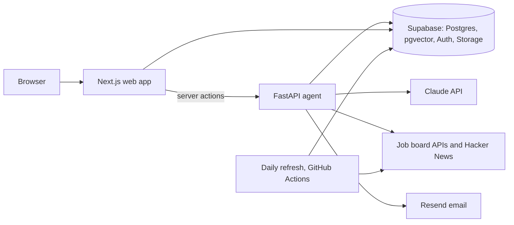

# Job Scout

A multi-user job search platform that finds openings matching each user's resume, scores the fit with Claude, and tracks applications from first look to outcome. The user always submits applications themselves.

Live at [job-role-scout-ai.vercel.app](https://job-role-scout-ai.vercel.app).

## What it does

- **Shared company directory.** Jobs come straight from the public APIs of 11 applicant tracking systems (Greenhouse, Lever, Ashby, Workday, SmartRecruiters, Workable, BambooHR, iCIMS, Jobvite, Personio, Recruitee) plus Hacker News "Who is hiring?" threads. Claude's web search finds new companies and their boards, and a daily refresh saves every open job, closes the ones that disappear and removes stale ones.
- **Resume-matched search.** Each search ranks matching jobs by semantic similarity to the user's resume, then scores the closest ones with Claude for fit, strengths and gaps, in rounds until enough reach the user's minimum score.
- **Scoring that learns from feedback.** Jobs the user rated good or bad are embedded, and the most similar ones go into the scoring prompt as examples.
- **Application tracker.** Jobs found by search and jobs applied to elsewhere, added by their link, in one list sorted by how far along each one is. Status history, follow-up reminders with drafted emails, resume gap analysis per job, and signals for reposted and likely ghost jobs.
- **Insights** on application outcomes, and an **admin console** for usage, cost, speed, failures and model quality.

## Using the app

1. **Sign in** with your email; the app sends a one-time sign-in link.
2. **Upload your resume** on the Resume page (PDF or Word). Searches rank and score jobs against your primary resume.
3. **Search from the Tracker.** Enter job titles or keywords, and optionally a company, location type, location, how recent the posting is, words to leave out, how many jobs to add and a minimum score. Matches appear on the Tracker as they're scored, each with its fit score, a summary of strengths and gaps, and warnings for reposted or long-open jobs.
4. **Rate and track.** Thumbs up or down tells future searches what a good fit looks like for you. Moving a job past "new" (saved, applied, interviewing, offer, rejected) takes it to the Jobs page, which keeps its status history and lists offers first and rejections last. From a job you can run a gap analysis against your resume or draft a follow-up email once an application has waited a while.
5. **Add jobs you applied to elsewhere** on the Jobs page by pasting the job's link, with its status and the date you applied. The app reads the job from its board and scores it against your resume; for a site it can't read, you enter the title and company yourself.
6. **Shape the directory** on the Companies page: hide companies you don't want searched, or add companies by name or job board link.
7. **Review Insights** for how your applications progressed, response rates by source, resume and whether search found the job, scoring accuracy against your ratings, and follow-ups that are due.

If you upload a new resume, the score button on the Tracker and on Jobs scores that page's jobs again against it. The Admin page is reserved for the site owner and covers usage, cost, speed, failures and model quality across all users.

## Architecture



Both services deploy to Vercel as one project (Vercel Services, configured in `vercel.json`). The browser only talks to Next.js, and server actions call the agent on the signed-in user's behalf, so row-level security applies to everything it reads and writes for them.

### How a search works

1. Match the user's rule (keywords, company, location, remote or on-site, posting age, exclusions) against the saved open jobs.
2. Rank the matches by similarity between each job's embedding and the resume's section embeddings (FastEmbed `bge-small-en-v1.5`, 384 dimensions, stored in pgvector).
3. Score the top candidates with Claude using structured outputs, prompt caching and the user's most similar past ratings as examples.
4. Repeat for up to three rounds until enough jobs reach the minimum score; jobs below it are saved outside the tracker.

## Tech stack

| Area | Tools |
|---|---|
| Web | Next.js 16 (App Router, Cache Components), React 19, TypeScript, Tailwind v4, shadcn/ui |
| Agent | Python 3.12, FastAPI, Pydantic, uv |
| AI | Claude API (Anthropic SDK), LangChain core, FastEmbed, pgvector |
| Data | Supabase Postgres with row-level security, Auth (magic links), Storage |
| Hosting | Vercel (Services), Supabase, GitHub Actions for the daily refresh |
| Infrastructure | Terraform on HCP Terraform |
| CI/CD | GitHub Actions, Dependabot |
| Testing | Pytest, Vitest, pgTAP, Ruff, Pyright, ESLint |
| Email | Resend |

## Observability and model quality

- **Every Claude call** is logged with its model, prompt version, tokens, cost and duration. The prompt version is a fingerprint of the system prompt and output schema, so a prompt change shows up as a new version.
- **The admin console** shows usage and Claude cost by step and by user, search speed, failures, board fetch and refresh results, page speed from real visits, and fit scores week by week for each prompt version.
- **Weekly evaluations** run in GitHub Actions: one scores held-out labeled jobs with and without examples, the other compares ways of picking which jobs to score. Results are saved and charted next to the live numbers.
- **Alerts** email the admin when the daily board refresh fails or can't reach job boards.

## CI/CD and infrastructure

| Workflow | When | What |
|---|---|---|
| `ci.yml` | Every push and pull request | Lint, type-check and test both services, audit dependencies, scan git history for secrets, rebuild the database from migrations and test its functions, then apply new migrations to production on `main` |
| `terraform.yml` | Changes under `infra/terraform` | Plan on pull requests, apply on `main` |
| `smoke.yml` | After each production deploy | Checks the site loads and reaches the agent |
| `refresh.yml` | Daily, or by hand | Fetches every board in the directory, saves its jobs and embeds the new ones |
| `evals.yml` | Weekly, or by hand | Runs the model evaluations |

Terraform (`infra/terraform`) manages the deployment configuration across Vercel, Supabase and GitHub, with state in HCP Terraform. The database schema is managed by migrations in `infra/supabase/migrations`.

## Security

- **Your data is yours.** Row-level security is on for every table, so each user can only read and change their own resumes, jobs and history, and resume files are stored privately per user.
- **Shared data** (the job and company directory) is readable by signed-in users and written only by the server. Internal tables are reachable by the server alone.
- **Every request is authenticated.**
- **Job sources** are public pages and APIs that need no credentials. Text from postings is treated as data in every prompt, never as instructions.
- **Secrets** never live in the repo, and CI scans every commit for leaks.

## Repository layout

- `apps/web`: Next.js app (pages, server actions, admin console)
- `services/agent`: FastAPI service with the search pipeline, Claude agents (`app/agents`), job board clients (`app/sources`), tests and evaluations (`evals`)
- `infra/supabase`: database migrations and local Supabase config
- `infra/terraform`: infrastructure as code
- `.github/workflows`: CI/CD

## Running locally

Requirements: Node 24, Docker Desktop running, uv (`brew install uv`).

```bash
npm install
npx supabase start --workdir infra   # local Postgres, Auth, Storage; applies infra/supabase/migrations
cd services/agent && uv sync && cd ../..
```

Copy `apps/web/.env.example` to `apps/web/.env.local` and `services/agent/.env.example` to `services/agent/.env`, filling the keys from `npx supabase status --workdir infra`.

```bash
npm run dev:agent   # http://127.0.0.1:8001
npm run dev:web     # http://localhost:3000
```

Magic-link emails land in the local inbox at http://127.0.0.1:54324. Supabase Studio is at http://127.0.0.1:54323.

Other tasks: `npm run build`, `npm run lint`, `npm run typecheck` and `npx turbo run test` (through Turborepo), `npm run test:agent` (pytest) and `npx supabase test db --workdir infra` (pgTAP, against the local database).
